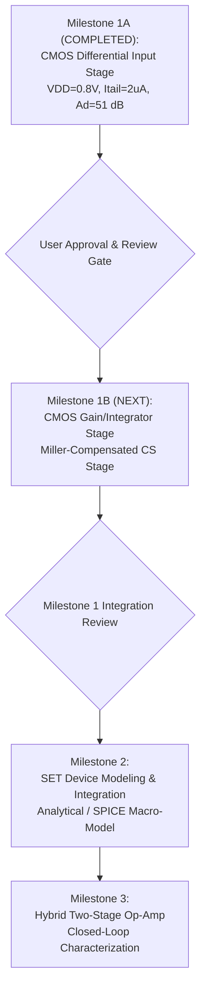

# Project Overview: Hybrid CMOS–SET Operational Amplifier

## 1. Executive Summary

This project develops an ultra-low-power **Hybrid CMOS–SET Operational Amplifier** designed and verified in LTspice on Windows. 

The design combines:
1. **CMOS Analog Building Blocks**: Standard Field-Effect Transistor topologies operating at low supply voltage ($V_{DD} = 0.8\text{ V}$) and sub-microampere tail currents ($I_{tail} = 2.0\text{ µA}$).
2. **Single-Electron Transistor (SET) Blocks**: Quantum-confinement devices exploiting Coulomb blockade phenomena to deliver periodic transconductance, ultra-high charge sensitivity, and compact multi-peak transfer functions (to be integrated in Milestone 2).

---

## 2. Milestone Architecture & Strategy

To guarantee electrical correctness and eliminate debugging ambiguity, the project follows a disciplined incremental methodology:

### Staged Breakdown:
- **Milestone 1: Independent CMOS Baseline Stages (No SET)**
  - **Circuit A (Current)**: CMOS Differential Input Stage with active PMOS current-mirror load and tail current biasing.
  - **Circuit B (Next)**: CMOS Voltage Gain / Integrator Stage with Miller compensation.
- **Milestone 2: SET Device Integration**
  - Incorporation of SPICE-compatible analytical / macro-models for Single-Electron Transistors (e.g., Mahapatra–Ionescu–Banerjee MIB model or orthodox Coulomb-blockade behavioral models).
  - Hybridization of differential pair or gain stage active loads using periodic SET elements.
- **Milestone 3: Complete Hybrid Op-Amp & System Characterization**
  - Closed-loop stability, phase margin, slew rate, common-mode rejection, and power-delay trade-offs.

---

## 3. Technology & Simulation Ground Rules

- **Platform:** LTspice (tested on version 26.1.1 64-bit for Windows).
- **Provisional Model Strategy:** Generic Level 1 MOSFET models ($V_{TO} = \pm 0.35\text{ V}$) are employed for topological proof-of-concept. No proprietary or fabricated foundry PDK is assumed.
- **Verification Integrity:** All simulation metrics reported in project documentation are directly parsed from actual `.log` files generated by running LTspice batch simulations locally. Zero metrics are fabricated or assumed.
