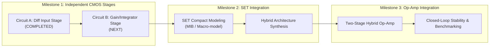

# Project Roadmap: Hybrid CMOS–SET Op-Amp

This document outlines the phased development plan for the Hybrid CMOS–SET Operational Amplifier.

---

## Phase Breakdown

---

## Milestone 1: CMOS Baseline Stages (Current Milestone)

- [x] **Milestone 1A: CMOS Differential Input Stage**
  - Architecture: NMOS differential pair ($M_1/M_2$) with PMOS active mirror load ($M_3/M_4$) and tail sink ($M_5$).
  - Target supply: $V_{DD} = 0.80\text{ V}$, $I_{tail} = 2.0\text{ µA}$.
  - Deliverables: `.asc` schematic, `.cir` netlist, generic Level 1 models, testbenches, and validation logs.
  - Achieved Metrics: $A_d = 50.97\text{ dB}$, $\text{CMRR} = 106.17\text{ dB}$, $\text{GBW} = 5.46\text{ MHz}$, $P_{diss} = 3.22\text{ µW}$.
  - **Status:** **COMPLETED & VALIDATED**. Awaiting user review before proceeding.

- [ ] **Milestone 1B: CMOS Voltage Gain / Integrator Stage**
  - Architecture: Common-source NMOS stage with PMOS active load and Miller compensation capacitor.
  - Target: High DC gain ($> 30\text{ dB}$), controlled dominant pole, and true integration behavior across specified frequency decade.
  - Deliverables: `CMOS_Gain_Integrator.asc`, `CMOS_Gain_Integrator.cir`, testbenches, and verified logs.
  - **Status:** **PENDING USER APPROVAL OF CIRCUIT A**.

---

## Milestone 2: Single-Electron Transistor (SET) Device Integration

- [ ] **Task 2.1: SET SPICE Modeling**
  - Select and implement a standard analytical SET compact model (e.g., Mahapatra–Ionescu–Banerjee MIB model or orthodox theory behavioral subcircuit).
  - Model Coulomb blockade, periodic conductance oscillations ($I_d - V_{gs}$), and single-electron charging energy ($E_c = e^2 / 2C_\Sigma$).
  - Validate against literature benchmark datasets at cryogenic/room temperature regimes.

- [ ] **Task 2.2: Hybrid CMOS–SET Topologies**
  - Explore SET integration opportunities:
    1. SET-based active load for ultra-high small-signal resistance.
    2. SET-CMOS differential input pairs exploiting oscillatory transconductance for multi-valued logic or phase-sensitive amplification.
    3. SET current references for sub-nanoampere biasing.

---

## Milestone 3: Complete Hybrid Op-Amp System

- [ ] **Task 3.1: Two-Stage Hybrid Op-Amp Synthesis**
  - Cascade Circuit A (Differential Stage) and Circuit B (Gain/Integrator Stage) with SET enhancements.
  - Frequency compensation (Miller capacitor + nulling resistor).

- [ ] **Task 3.2: Closed-Loop Characterization**
  - Phase Margin ($\text{PM} > 60^\circ$) and Gain Margin ($\text{GM} > 10\text{ dB}$) under varying capacitive loads ($1\text{ pF}$ to $10\text{ pF}$).
  - Slew rate ($\text{SR}$) and large-signal step response.
  - Common-mode and Power Supply Rejection Ratios (CMRR, PSRR+ / PSRR-).
  - Final engineering report and tapeout-readiness review.
